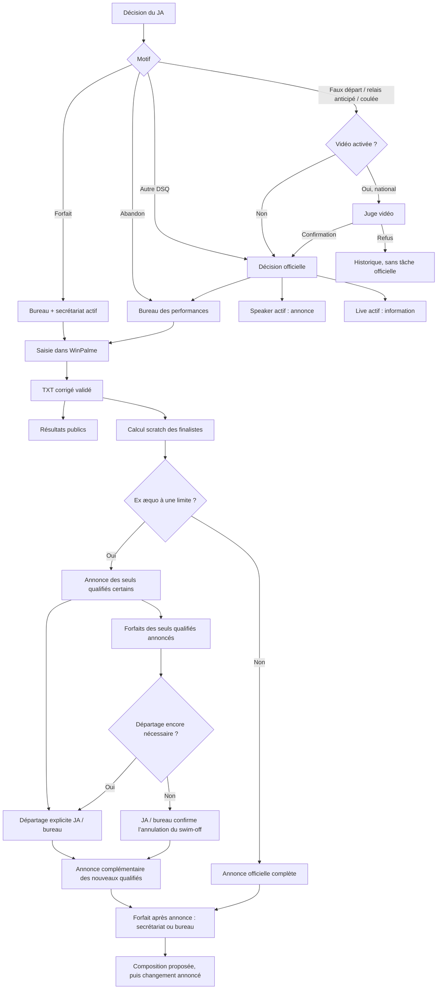

# LivePalmes Direct

<!-- description: Périmètre, démarrage local, publication et fonctions propres aux consoles du dispositif LivePalmes Direct. -->

## Sessions publiques et séries décalées — demande du 10 novembre 2026

Après livraison du bureau/accès, Antoine demande un filtre public quand plusieurs sessions existent, une sélection initiale suivant les résultats publiés et un scratch commun aux séries lentes/rapides réparties sur plusieurs sessions. Le PDF de Limoges présente huit sessions, notamment le 1 500 m Surface femmes : série 1/2 en session 1 à 10 h 40, série 2/2 en session 2 à 18 h 40. Imports, clés NAP et correspondance des fichiers WinPalme restent par session ; seul le modèle de lecture publique est regroupé. Les finales A/B restent distinctes.

Regroupement prudent : même code d’épreuve, sexe et phase identique (séries ou meilleures séries), nombre total de séries cohérent et numéros de séries disjoints entre sessions. Une répétition autonome complète ou des numéros qui se recouvrent ne sont pas fusionnés. Des participations ambiguës entre fragments font conserver la vue par session avec avertissement, sans classement commun inventé. Les horaires et numéros originaux restent visibles par série. Avant résultats : engagements communs ; ensuite résultats publiés et classement provisoire commun, suivant le fonctionnement existant. L’épreuve ne devient terminée qu’avec l’ensemble des séries attendu.

À l’ouverture sans lien de course précis : dernière session ayant des résultats publiés, course partielle de cette session si disponible, sinon dernière terminée ; sans résultat, début du programme. L’ordre est celui du programme, pas celui des corrections de fichiers. Une sélection volontaire est conservée lors du bouton Actualiser. Boutons compacts Tous / S1 / S2… sur une ligne défilante, masqués en session unique ; intitulé complet et date disponible dans le nom accessible et le titre. L’heure de dernière actualisation réussie est discrètement intégrée au bouton Actualiser, sans ligne permanente ni mention « manuelle » ; erreurs toujours visibles. Aucun minuteur public. Les dates de session ne sont pas déduites arbitrairement du nombre de sessions : affichage des dates disponibles uniquement.

Budget défini avant implémentation : réemploi du programme/agrégat et du cache mutualisé existants. Ouverture, choix d’une course/session et rafraîchissement conservent un RPC public et les mêmes requêtes : métadonnées ciblées, programme/agrégat en cache, un SELECT de participations par clé compétition et liste bornée d’identifiants source (au plus 300), limité aux 1 000 participations de la course, puis projection privée minimale Q existante. Aucun appel par session ou nageur ; aucune lecture Firestore, nouveau listener, table, migration ou reconstruction de toute la compétition. Filtrage/navigation locaux sans lecture ; seul le choix d’une autre course appelle le serveur. Pire cas de 400 ouvertures concurrentes identiques : une seule lecture groupée de participations partagée par le cache, hors métadonnées existantes. Le programme complet des fiches nageurs conserve son budget séparé de 15 000 lignes maximum. Contrôle MySQL isolé de la lecture IN indexée et régressions des imports/session requis avant TEST.

## Accès par compte et actions bureau — 10 novembre 2026

Antoine autorise l’intégration et TEST du bilan : cartes du bureau sans « Voir la course », contexte course/sexe/session et série/ligne visible, confirmation « Saisi dans WinPalme » à droite. Elle confirme la saisie manuelle et n’écrit jamais dans WinPalme. Dans Consoles et réglages, « Accès et délégations » ouvre une liste des comptes, responsabilités/consoles, expiration et état. Ajout, modification et retrait confirmé remplacent l’ancien formulaire dont un template était affiché littéralement. Un accès retiré peut être rétabli ; aucun compte ni délégation n’est supprimé.

Une délégation cible un compte existant actif, pour la gestion du Direct ou une ou plusieurs consoles activées de cette seule compétition. Les contrôles région/national, bureau, expiration, révocation et version concurrente restent côté serveur ; aucun droit portail, PIN ou règle globale ne change. Une modification par identifiant exige une délégation déjà présente pour cette compétition. Le retrait reste possible si le compte est devenu inactif ou absent. La résolution des identités est groupée et privée, sans secret ni jeton retourné.

Après connexion : Mes compétitions, puis Mes consoles pour les personnes sans responsabilité bureau. Une compétition accessible unique s’ouvre directement ; une URL explicite non autorisée affiche une erreur sans ouvrir une autre compétition. Les consoles activées et autorisées sont des liens tactiles avec copie/QR. Les liens et QR précis conservent leur destination à la connexion. Les responsables retrouvent le bureau existant. L’accueil des consoles n’installe aucun polling privé ; les contrôles d’accès sont renouvelés à l’ouverture de chaque console.

Budget avant implémentation : ouverture initiale, choix, rafraîchissement et retour à la liste réutilisent les appels list/detail existants, sans lecture par carte. Une ouverture du panneau des accès ajoute un RPC à la demande : lecture native ciblée, contrôle de délégation si nécessaire, deux SELECT bornés (configuration et 101 accès maximum ; erreur au-delà de 100), un Auth getUsers groupé et un Firestore getAll de 100 profils maximum, aucune lecture par ligne ni listener. Réouverture locale : zéro appel ; Actualiser relit le même lot. Ajout/modification/retrait réutilisent la transaction et le journal existants ; une modification par UID ajoute une liste bornée, une seule résolution de compte si rétablissement/modification, aucune au retrait. Contrôle des consoles : une lecture de configuration ciblée. Après écriture, retour de version transactionnelle, relecture du panneau et snapshot bureau existant, sans arrêter la surveillance des résultats. Pire cas de quatre bureaux ouvrant 100 délégations chacun : au plus 400 profils, quatre appels groupés Auth et quatre RPC ; coût indépendant du nombre total de comptes/compétitions et aucun impact sur le public. Pas de nouvelle table, migration, écriture métier de recette ni PROD. Tests MySQL isolés requis pour les plans des accès existants et les versions.

## Bureau et finales — maquette validée, intégration TEST du 9 novembre 2026

Antoine valide la maquette puis autorise intégration, vérifications et TEST : bureau pleine largeur avec surveillance et programme quand il est seul ; arbitrage au centre et suivi permanent à droite avec les consoles. Bandeau compact, réglages et accès repliés ; historique unique avec filtres décisions/annonces et publications. L’onglet Finales n’apparaît que si une course est configurée ; son paramétrage reste accessible dans Réglages. Le secrétariat utilise Finales, Notifications et Historique, sans programme ni navigation des séries. La vidéo conserve ses règles et composants historiques ; les validations tactiles sont contrôlées à 1 024 × 768.

Libellés utilisateurs : « Publication des résultats », « Surveillance active / en pause », « Dossier des résultats WinPalme », « Dernier contrôle », « Dernière publication » et « Dernier résultat reçu ». Le format .txt reste mentionné seulement pour identifier les fichiers. Le guide HTML, ses captures/logigrammes et son PDF sont régénérés depuis leurs sources. Les consoles activées proposent leur lien, « Copier » et « QR code » dans le menu Consoles/réglages : génération locale via le fournisseur QR déjà présent, aucun appel métier ou tiers ajouté, aucune connexion ni permission contournée.

Un forfait après 30 minutes reste réservé au finaliste officiellement annoncé : bureau sans secrétariat actif ou secrétariat, avec confirmation explicite `confirmLateWithdrawal=true`. Le serveur refuse le dépassement sans cette confirmation. Échéance et caractère hors délai sont conservés dans le journal privé. Aucun nouveau rôle ni délai automatique.

Le public reçoit uniquement Q (A seule), QA/QB (A+B) par participation, depuis la composition annoncée. Un forfait retire le marqueur au prochain rafraîchissement manuel ; une proposition de repêchage ne donne aucun Q avant son annonce. Les ex æquo non départagés restent sans Q. Aucune identité de compte, décision, heure privée ou liste de réservistes n’est exposée. Temps alignés, écarts discrets, catégories complètes et lignes compactes conservés.

Budget conçu avant implémentation : réemploi des snapshots/agrégats et du minuteur privé existants pour le bureau, sans lecture par course ni nouveau minuteur. Si la sélection mémorisée n’a pas de finale, l’ouverture des Finales au bureau ou du secrétariat sélectionne la première course configurée ; au plus un snapshot ciblé supplémentaire à l’ouverture, sans boucle ni appel par option. Une ouverture publique ou un rafraîchissement de révision non encore en cache ajoute une seule lecture SQL par clé (environnement, compétition, identifiant d’état), limitée à une ligne et à la projection JSON des courses ; zéro lecture supplémentaire sur un cache partagé déjà rempli, aucune lecture Firestore ajoutée. Une action qui change les marqueurs annoncés ajoute un UPDATE de la seule révision publique sous le verrou de configuration existant ; le rejeu idempotent n’écrit pas de nouveau. Les autres actions conservent leur budget. Pire cas : 400 ouvertures concurrentes d’une même sélection partagent la lecture d’état ; sélection privée inchangée, pas de N+1, nouvelle table, migration ou écriture réelle de test.

Publication prévue par le complément fermé aux deux consommateurs Direct calculés, sources/labels TEST seulement, puis Hosting commun et contrôle final. Aucun autre service, configuration, permission ou PROD. Validation de la maquette acquise ; validation utilisateur de la réalisation TEST encore attendue.

## Corrections après audit des consoles — 9 novembre 2026

Le bureau reste unique. Son volet ouvert propose Arbitrage / Finales / Imports / Historique ; le dossier TXT reste visible au-dessus, le détail des imports est affiché à la demande. Le volet, la course et la session sont conservés par compte, compétition et rôle sur cet appareil. L’identifiant de la compétition reste dans l’adresse du bureau. Les commandes sont neutralisées pendant les chargements ; une réponse tardive ne remplace pas une nouvelle sélection.

Les consoles continuent leur lecture privée à 15 secondes pendant un programme, une décision ou des réglages en cours. La fenêtre reste ouverte et la saisie est conservée ; un encart y affiche les informations reçues. Speaker/Live montrent les deux alertes les plus récentes, les précédentes restent dépliables dans une zone bornée, avec un bouton flottant d’accès aux informations. Une commande concurrente est toujours refusée : « Vérifier les changements » relit le contexte et conserve le brouillon, puis demande une nouvelle confirmation explicite. Aucun renvoi automatique après conflit. Un envoi réseau incertain conserve sa clé idempotente existante. Les confirmations courantes utilisent des dialogues HTML, y compris au-dessus d’un brouillon ; la déconnexion les ferme.

Secrétariat : finale sélectionnée et forfaits avant les contextes secondaires, réservistes repliables, échéance de forfait tirée de l’annonce initiale ou individuelle existante. Bureau de secours : mêmes boutons de forfait de 44 px sur tablette. Programme, connexion, annonces et commandes essentielles ont aussi une cible de 44 px aux dimensions tablette, sans augmenter les lignes des nageurs. Les changements de composition précisent entrées/sorties ; les annulations JA conservent leur provenance et les MPF masters féminins sont libellés F30+/F40+ selon le contexte, sans changer les références sportives.

Remise à zéro privée autorisée explicitement par Antoine : dans Historique, « Réinitialiser les consoles » confirme l’effacement des décisions, journal privé, repère JA et formats/annonces de finales de cette seule compétition. Les séries, résultats publics, PDF, configuration d’activation et délégations ne sont pas touchés. Le bureau utilise son accès de console existant, sans nouvelle capacité portail. L’état vide conserve une révision strictement croissante ; état et reçus sont traités sous le même verrou transactionnel. Les anciens reçus privés sont supprimés, seul le reçu technique de la remise à zéro reste pour reprendre une réponse perdue. Un ancien envoi ne peut pas recréer l’état supprimé.

Budget avant implémentation : ouverture, rafraîchissement complet et cycle inchangé conservent les requêtes bornées documentées plus bas. Le cycle de 15 s inclut maintenant les fenêtres ouvertes ; aucun second minuteur, listener ou appel par ligne. Pire cas de 20 postes visibles : 80 cycles/min, environ 240 requêtes SQL/min pour des responsables (une lecture ciblée supplémentaire par délégué), 4 800 profils Firestore/h, hors changements/actions. Les onglets masqués restent en pause. Une vérification de conflit ajoute un seul snapshot complet à la demande. La remise à zéro garde les contrôles d’accès existants et trois lectures transactionnelles par clé (configuration, reçu, état), puis deux écritures et un DELETE des reçus limité par environnement/compétition ; elle ne lit pas le programme ni les participations. Aucun changement de schéma ni de règle sportive, aucun rafraîchissement public automatique.

## Mode opératoire régional et accès depuis le portail

[Guide utilisateur sur TEST](https://livepalmes-test.web.app/direct-guide.html), avec PDF illustré téléchargeable, accessible par « Mode opératoire » dans le bureau. Livraison Hosting contrôlée du 9 novembre, candidat d83e5a85 / [run 42533891137](https://github.com/ffessmnap/LivePalmes/actions/runs/42533891137), sans modification backend ; recette utilisateur finale attendue. Source : `direct-guide.html` et `assets/direct/guide.css`. Captures générées par `node tools/capture-direct-guide.js`, exclusivement depuis le vrai HTML et une fixture SQL en mémoire, sans donnée ni accès métier réel. Génération des deux copies identiques du PDF (livrable local sous `output/pdf/` et téléchargement Hosting) par `node tools/build-direct-guide.js` ; aucun accès métier ou service réel. Les pages générées sont contrôlées visuellement avant livraison.

Le guide couvre le bureau seul, les consoles régionales, les décisions/forfaits/abandons, les finales et enfin la vidéo nationale. Repère de navigation WinPalme fourni par Antoine : Data → bonne bibliothèque → `renc` → rencontre concernée → `ResultatsSeries`.

Le portail ouvre désormais ce bureau via « LivePalmes Direct », même icône, pour les profils régionaux/nationaux et admin.full. Aucun accès serveur changé ; ancien pilotage national encore disponible à son URL, retiré des liens du portail. Budget ajouté du menu, du guide et de son téléchargement : zéro lecture NAP/Firestore, écriture, appel métier ou listener. Les ouvertures du bureau conservent leurs contrôles et budgets existants.

## Six consoles multi-compétitions — ergonomie historique et bureau unique

Une seule page bureau : `direct-admin.html?id=ID_NAP` réunit import PDF, surveillance TXT, décisions à traiter, finales et accès. L’URL du rôle bureau `direct-consoles.html?id=ID_NAP&role=computer` redirige vers ce bureau ; aucun second bureau, iframe ou second abonnement d’authentification. Les réglages et explications facultatives restent repliés ; seules les erreurs utiles sont mises en évidence. Les commandes privées ne coupent pas la surveillance TXT.

`direct-consoles.html?id=ID_NAP&role=ROLE` ouvre le JA (`referee`), la vidéo (`video`), le speaker (`speaker`), le secrétariat (`secretary`) ou le Live (`live`). JA, vidéo, speaker et Live utilisent les vues pures historiques et leurs feuilles de style : mêmes panneaux, lignes cliquables, grille de motifs, pastilles, fenêtres, files vidéo et cartes d’historique. Les sources des anciennes pages nationales générées restent inchangées ; leurs anciennes données/PIN/synchronisations Firestore ne sont pas chargés. Le secrétariat conserve une ergonomie adaptée aux nouvelles finales. Grandes tablettes : JA, vidéo, Live et secrétariat ; bureau et speaker : ordinateur, avec accès tactile maintenu. Aucun environnement métier parallèle, compte de démonstration ou PIN ajouté.

Le bureau peut fonctionner seul. Activer une autre console rend le JA obligatoire ; la vidéo est réservée au niveau national. Le bureau peut déléguer les consoles de cette seule compétition à des comptes LivePalmes actifs existants, éventuellement utiliser le même compte sur plusieurs appareils. Les capacités globales du portail ne changent pas. Un accès désactivé ou expiré est contrôlé de nouveau à chaque appel.

Décisions : forfait vers bureau/secrétariat actif ; abandon vers bureau ; faux départ, départ anticipé de relais et coulée >15 m vers la vidéo lorsqu'elle est activée. Les autres DSQ et toutes les décisions sans vidéo vont directement au bureau et au speaker actif. Une confirmation vidéo crée les tâches officielles ; un refus reste dans l'historique. Annulations JA et réqualifications du délégué déclenchent les corrections nécessaires. Sans speaker, le bureau confirme les annonces effectuées hors application ; sans secrétariat, il saisit les forfaits depuis sa console tablette. La console Live consulte les informations officielles et peut les masquer sur son seul appareil.

Le JA pointe sa série comme repère commun, sans déplacer les autres consoles ni la page publique. Les échanges privés sont relus toutes les 15 secondes, avec pause uniquement en onglet masqué ; les fenêtres et saisies ne suspendent pas la réception. Aucun mode Direct/Manuel supplémentaire. Le public conserve son actualisation manuelle. Les décisions des consoles ne remplacent jamais les temps/statuts des TXT : le bureau les saisit dans WinPalme et attend le fichier corrigé ; une divergence bloque l'annonce des finalistes.



Finales au scratch uniquement : réglage groupé ou par course « aucune / A / A+B », avec 6 ou 8 places par finale, indépendant du décalage de ligne TXT. Les séries du même code épreuve/sexe sont regroupées entre sessions, sans inclure les finales déjà importées. Une participation répétée ambiguë bloque le calcul. Toutes les séries doivent avoir leurs résultats ; DSQ, abandon et forfait sont exclus des qualifiés. Un ex æquo à une limite utile (6/7, 12/13, 8/9 ou 16/17) demande un départage explicite JA/bureau ; aucun choix automatique par nom ou ligne. Son ordre est enregistré sans changer les temps. Un swim-off prévu devenu inutile nécessite confirmation d'annulation et information du speaker.

Aucun forfait de finale avant l'annonce officielle des finalistes, y compris pour un repêché encore proposé. La fenêtre existante de 30 minutes commence à l'annonce ; le nouveau réserviste qualifié a sa propre fenêtre après annonce du repêchage. Les pré-forfaits des réservistes ne s'ouvrent qu'après l'annonce initiale. Forfait/réintégration prépare une composition qui reste à annoncer ; l'ancienne composition annoncée est conservée jusqu'à confirmation. Une correction des résultats ou une nouvelle version des séries après annonce impose une revue explicite. Le placement dans les lignes et la saisie des compositions restent dans WinPalme. En cas d’ex æquo, l’annonce initiale peut porter uniquement sur les qualifiés certains : les places restantes sont signalées en attente de départage. Seuls les nageurs nommément annoncés peuvent déclarer forfait ; les nageurs à départager ne peuvent pas être retirés par un pré-forfait. Si un forfait supprime le besoin de départage, le JA/bureau confirme l’annulation du swim-off avant l’annonce complémentaire. Un départage saisi après annonce partielle prépare automatiquement cette nouvelle annonce. Les nouveaux qualifiés obtiennent leur fenêtre de 30 minutes à cette annonce ; les qualifiés certains conservent l’heure initiale.

Persistance : réutilisation des cinq tables Direct existantes, sans table/colonne/collection ou migration. `livepalmes_direct_publications` contient un état privé `console-state` déterministe et des reçus `console-command`, toujours isolés par environnement et compétition. Les commandes verrouillent la configuration, contrôlent sa version et celle du workflow, puis écrivent état et reçu dans une seule transaction. Une réponse perdue se rejoue avec le même identifiant ; une autre action avec cet identifiant est refusée. La révision privée ne modifie pas celle des publications TXT. Réinitialiser le Direct supprime également cet état et cet historique en conservant activation et accès. Bornes : état 2 Mio UTF-8, 2 000 décisions, 5 000 actions ; aucun effacement automatique silencieux.

Budget de lectures prévu (indépendant du volume global NAP) :

- Ouverture/actualisation complète : un profil Firestore actif, métadonnées natives/configuration/révision JSON/état par clé, une délégation par clé si nécessaire, programme limité à 301, agrégat de progression limité à 15 001 et participations sélectionnées limitées à 1 001. Les qualifications multisessions ajoutent une seule lecture `IN` bornée à 15 001 ; la source unique réutilise les participations sélectionnées.
- Cycle inchangé : un profil, métadonnées natives, configuration et révision JSON par clé ; une délégation si nécessaire (3 requêtes SQL pour un responsable, 4 pour un délégué). Aucun programme ni tableau de participants relu. Dix consoles visibles pendant quatre heures représentent au plus 9 600 cycles, hors actions/changements ; les onglets masqués n'en font pas.
- Action : contrôles d'accès existants, verrou de configuration, reçu et état par clé ; programme/épreuve bornés et une lecture groupée qualificative si nécessaire, puis deux écritures privées transactionnelles. Aucun appel par nageur ou course. Les imports conservent leur propre budget.
- Fiche nageur : un lot privé de compétition limité à 15 001, mutualisé et mis en cache par compte/rôle/version ; aucune lecture par course. Records/MPF : un appel groupé existant à l’ouverture du speaker/Live, mutualisé, puis seulement à la demande ; mêmes filtres que le public, sans nouvelle règle sportive.
- Historique : les 300 dernières actions avec le snapshot, export imprimable/PDF en un appel borné aux 5 000 actions. Le bureau unique consulte un signal privé toutes les 15 secondes si des consoles terrain sont actives et le volet arbitrage est fermé, sans relire les participations. Volet ouvert : un seul snapshot avec le même budget que les autres postes, sans signal supplémentaire. Aucun snapshot au montage du volet fermé, aucune requête par ligne. Le public ne reçoit pas cet état.

Les plans et transactions réels sont vérifiés dans le MySQL 5.7 isolé de la CI. Aucune écriture réelle NAP, import de données fictives sur TEST ou activation de console par les tests automatisés. [Livraison TEST contrôlée](https://github.com/ffessmnap/LivePalmes/actions/runs/42521333540), candidat 613b7d25, Hosting 594bf6b282b3901e ; [preuves et limites](releases/EVOLUTIONS.md). Cette première livraison a reçu un retour utilisateur demandant le rétablissement de l’ergonomie historique et un bureau unique ; la correction est [publiée sur TEST](https://github.com/ffessmnap/LivePalmes/actions/runs/42528577712) en c791e1ee, Hosting f73685743f04de63. Bureau unique et vues historiques prêts pour la recette du pilote, qui reste attendue. Aucune autorisation PROD pour ce lot.

## Perimetre

LivePalmes Direct accompagne les compétitions piscine de tous niveaux issues du calendrier NAP. Le nouveau parcours multi-compétitions est publié en PROD. Le dispositif national historique conserve ses pages et ses protections. La préparation des engagements reste dans le Portail LivePalmes.

## Mise en service PROD pour Paris le 7 novembre 2026

La [publication officielle](https://github.com/ffessmnap/LivePalmes/actions/runs/42314016120) promeut le candidat TEST `5b76e1e` après accord explicite d'Antoine et contrôles réussis. Le gestionnaire Direct et le lecteur public sont les deux seuls services actualisés. Les 115 autres révisions et les témoins mail et automates sont conservés. Les 23 fichiers applicatifs servis et le public à 1 280/390/320 px sont vérifiés.

Paris 5220, Championnat régional IDF manche 1 du 7 novembre à la piscine Georges-Hermant, est activé dans le seul environnement `production`. Le compte national existant d'Antoine possède les droits nécessaires. [Bureau PROD](https://livepalmes.web.app/direct-admin.html) et [public Paris](https://livepalmes.web.app/direct.html?id=5220). Le pilote importe ses vrais PDF puis choisit son dossier WinPalme dans Chrome/Edge. Vérifier les premières lignes TXT/PDF à la première ouverture, notamment 1 vers 2 si cette répartition s'applique. L'onglet et le poste doivent rester ouverts et éveillés.

Les sauvegardes ponctuelles avant publication et après activation sont rouvertes, comparées et restaurées dans MySQL 5.7 isolé, avec artefacts chiffrés conservés 14 jours. La restauration préserve notamment le JSON null du journal d'activation. Les sauvegardes ne sont pas automatisées et la couverture hébergeur n'est pas attestée. [Preuves, autorisation et limites](releases/EVOLUTIONS.md).

Après accord ciblé d'Antoine, le compte CI backend reçoit le 7 novembre le rôle `roles/secretmanager.secretAccessor` sur le seul secret `LIVEPALMES_NAP_PASSWORD` du projet `livepalmes`, avec sauvegarde IAM vérifiée et contrôle de dérive. Les sauvegardes ponctuelles et leur mode de lancement restent ceux décrits ci-dessous.

## Public — raccourci catégorie et titre sur une ligne (7 novembre 2026)

Évolution autorisée après le pilote Paris et [livrée sur TEST](https://github.com/ffessmnap/LivePalmes/actions/runs/42406632285) dans le candidat `8b9101a2` : cliquer une pastille de catégorie sur des résultats applique cette catégorie au scratch, avec ses places de catégorie existantes. La multisélection reste disponible ; une croix discrète près du sélecteur permet de tout effacer. Le raccourci ne déclenche pas la fiche nageur, ne filtre pas la composition des séries et ne lit aucune donnée supplémentaire. Le titre du bandeau tient sur une seule ligne, avec ellipse et défilement horizontal du texte complet au toucher/clavier. Périmètre : client public, styles, tests et documentation ; règles sportives, données, backend et consoles inchangés. Recette utilisateur attendue sur cette version, sans promotion PROD.

Budget : ouverture, changement d'épreuve et rafraîchissement identiques à l'existant ; clic sur une catégorie, multisélection, suppression et lecture du titre = zéro appel. Aucun coût supplémentaire dans le pire cas de 1 000 participations par épreuve ; les classements réutilisent les données chargées et le calcul déjà présent, sans nouveau chargement de compétition.

## Lecture TXT — filtre de début de ligne du 7 novembre 2026

Après le pilote Paris confirmé réussi par Antoine, règle explicitement demandée et [livrée sur TEST](https://github.com/ffessmnap/LivePalmes/actions/runs/42404070287) dans le candidat `26b7996b` : seules les lignes commençant exactement par un chiffre de 1 à 8 immédiatement suivi de `;` sont analysées (`^[1-8];`). Les préfixes `4 4`, `4-4`, `6` seul, `4:`, `04;`, `9;`, les espaces avant le chiffre ou entre le chiffre et `;`, le texte et le remplissage sont ignorés. Le BOM UTF-8 éventuel reste pris en charge. Cette règle remplace la tolérance historique du séparateur `:` en début de ligne.

Les sept champs, temps, passages, statuts forfait/absence, abandon et disqualification, doublons identiques ou contradictoires restent contrôlés comme auparavant. Ignorer une ligne ne permet pas de publier une série dont une participation attendue manque : seul le TXT concerné reste à vérifier, les autres continuent. Un fichier sans ligne reconnue reste suivi sans publication ni alerte. Périmètre client et fixtures de tests uniquement, sans évolution des tables, backend ou droits, sans écriture réelle ; budget de lectures serveur inchangé (zéro appel pour filtrer, appels groupés existants pour publier). Livraison limitée à TEST, consoles des juges reportées.

## Direct multi-compétitions — livraison TEST du 6 novembre 2026

Lot regroupé publié sur TEST le 6 novembre à 23 h 43 (Paris), candidat `5b76e1e37eddba618b25c41c92a8168446fe4115`, [publication commune réussie](https://github.com/ffessmnap/LivePalmes/actions/runs/42306711779). Contrôles connectés : quinze fichiers identiques au candidat, public à 1 280/390/320 px sans débordement, 119 fonctions actives avec toutes leurs révisions conservées. Tests de publication sur fixtures uniquement, aucune écriture métier réelle. [Preuves et limites](releases/EVOLUTIONS.md) ; recette de cette nouvelle version attendue.

### Lecture mobile, références et remplissage TXT — livré sur TEST, recette attendue

Complément visuel approuvé par Antoine pendant la livraison précédente : reprendre l'ancienne palette sur le seul libellé de catégorie, dans les séries et les résultats. Le code reçu reste inchangé ; codes WinPalme et libellés déjà connus sont associés à leurs teintes historiques, inconnus neutres. Pas de calcul d'âge ou de reclassement, pas de lecture supplémentaire, pas de changement backend. Pastille compacte avec texte foncé, hauteur inchangée et surbrillance du club conservée ; largeur mobile de catégorie adaptée aux codes à quatre caractères.

Complément TXT précisé ensuite : ignorer les lignes ne contenant que des séparateurs (`;;`) et celles dont le premier champ est `0000` ou `000000` (au moins quatre zéros), sans ignorer un vrai temps `002500` après un numéro de ligne. Les lignes de texte hors format de résultat sont également ignorées ; un numéro de ligne suivi de séparateurs reste contrôlé (temps, statut, passages et doublons contradictoires). Un fichier ne contenant que ce remplissage ne produit ni publication ni avertissement ; la surveillance reste active et traite une version ultérieure contenant des résultats après les deux lectures stables habituelles.

Dernier complément explicitement demandé : vérifier les codes H40+/H60+ sur mobile, regrouper les références sous un bouton Records et réserver RF/RFJ au bassin 50 m avec chronométrage électronique. Le champ calendrier `competition.timingType`, déjà lu et exposé par le service Direct, pilote ce filtre local ; manuel ou inconnu = MPF de toutes les catégories présentes, seniors/juniors compris, comme en bassin 25 m. Aucun nouveau champ, appel ou calcul sportif. Budget inchangé : une lecture Records existante à l'ouverture, zéro requête pour déplier le panneau ou changer de catégorie.

### Reprise TXT et accès public — livré sur TEST, recette attendue

Antoine confirme le 6 novembre que la remise à zéro et l'import précédent fonctionnent ; le refus de reprise provenait de la première ligne restée à 1 au lieu de 2. Nouveau lot autorisé : mémorisation locale des premières lignes et associations par origine, compte et compétition, revalidation contre le programme courant, confirmations toujours décochées et dossier choisi explicitement. Aucun préfixe à saisir : détection des noms `<préfixe>_AS_<session>_<épreuve>_<série>_<course>.txt`, y compris dossier initialement vide ; mélange de compétitions toujours bloquant.

Les lignes strictement identiques répétées dans un TXT sont ignorées (sept champs comparés après séparation et retrait des espaces périphériques). Un même numéro avec des contenus différents reste bloqué. Un TXT incompatible est signalé avec son nom et les lignes TXT, après décalage et importées ; les autres TXT stables continuent, par lots de 100, sans écriture du fichier bloqué. Les corrections compatibles sont reprises automatiquement ; erreur réseau, perte d'accès au dossier ou incohérence serveur restent bloquantes avec reprise explicite. Une correction du seul temps ne change pas l'empreinte des séries.

Budget inchangé : réglages et contrôles locaux = zéro lecture serveur ; ouverture de dossier = un `watchContext` borné existant, lot valide = `previewBatch` puis `publishBatch` existants, aucun appel pour un TXT bloqué localement et aucun appel par nageur. Aucune modification backend, schéma, droit ou donnée native. Recette du bureau sur ordinateur ; public sur ordinateur et mobile.

Colonne publique toujours « Pl. », avec nom accessible et titre précisant scratch ou catégorie. Calendrier et fiche compétition : pastille LivePalmes Direct, pulsation du seul point aux dates de compétition active non annulée ; archive et dates hors compétition fixes, préférence de réduction des animations respectée. Aucun rafraîchissement automatique ajouté.

### Remise à zéro et import des séries par session — livré sur TEST, recette attendue

[PR #742](https://github.com/ffessmnap/LivePalmes/pull/742), [publication TEST contrôlée](https://github.com/ffessmnap/LivePalmes/actions/runs/42292683226) du 6 novembre : candidat `90b77cd785746cb703fdbc2136650c444f4bb2f4`, Hosting `9e1c741fe1a6e453`. CI complète, vrais DELETE en MySQL 5.7 isolé et parcours du bureau sur données fictives réussis ; neuf fichiers servis identiques et page publique vérifiée à 1 280/390/320 px. Aucune remise à zéro ni publication de PDF réelles pendant les contrôles. Activation et accès préservés par les essais ; recette authentifiée par le pilote encore attendue.

Antoine demande l'effacement définitif des imports du Direct, sans historique conservé, et confirme le maintien de l'activation et des accès. Le bouton « Tout réinitialiser » concerne la seule compétition choisie et l'environnement serveur. Confirmation par saisie de SUPPRIMER, arrêt de la veille, contrôle des droits Storage sans les modifier, puis suppression des participations, épreuves, PDF du préfixe dédié (anciennes versions incluses), historique et reçus. Le calendrier, les performances officielles, les comptes, les délégations et les réglages du Direct sont conservés. Aucune remise à zéro réelle n'est comprise dans les contrôles de livraison.

La suppression est reprise par étapes explicites : état interne `resetting`, page publique temporairement masquée, autres écritures bloquées, verrou de configuration et version à chaque étape. Un marqueur opérationnel temporaire dans la table de publications ne contient que phase, compteurs et réglages à restaurer ; aucune copie d'import et aucun marqueur ne subsistent après réussite. Une coupure permet Reprendre la suppression après actualisation. Les versions/révisions restent croissantes pour refuser les demandes anciennes et invalider les caches. Aucune nouvelle table/colonne, règle Firebase ou modification de capacité.

Budget : début = profil privé et éventuelle délégation existants, métadonnées natives par clé, verrou de configuration et un test IAM Storage de lecture avant mutation. Étape = mêmes contrôles, un marqueur par clé, au plus 51 objets Storage listés dans le préfixe environnement/compétition et 50 suppressions (cinq simultanées maximum), au plus 1 000 participations, 301 épreuves et 1 000 entrées d'historique supprimées par requête bornée. Pas de sélection des anciennes données par ligne ni de scan global NAP/Storage. Le bureau limité à la reprise lit trois lots SQL (métadonnées/configuration/marqueur) au lieu du programme complet. Une action du navigateur est bornée à 200 étapes, puis reprise explicite si nécessaire. Hors réinitialisation, les budgets des lectures publiques/privées restent inchangés.

Le bouton Importer les séries (PDF) est dans le bloc de compétition. Le choix de fichiers lance la lecture locale ; l'import PDF de résultats n'est plus proposé dans le bureau. Les exports XML restent hors périmètre. Une option par fichier propose de publier le PDF complet choisi après publication de toutes ses épreuves, sans deuxième sélection de fichier ; un échec laisse une reprise PDF sans remettre en cause les séries publiées. Le dépôt manuel des PDF complets reste disponible. Fichiers limités à 20 × 10 Mo ; publication optionnelle = au plus un appel `document` par fichier, jamais par course. Envoi séquentiel, identifiant stable par nom de fichier et session pour conserver plusieurs PDF tout en remplaçant un fichier corrigé. Le verrou de compétition précède le téléversement pour empêcher une course avec la remise à zéro.

Filtres locaux par session/date dans le suivi et les aperçus, présents seulement à partir de deux sessions. Le filtre d'aperçu borne sélection globale, vérification et publication à la session visible ; changer de filtre invalide la vérification. Aucune épreuve cachée n'est publiée. Un PDF multisession attend toutes ses épreuves avant sa publication complète. Filtrer ne lit aucune donnée supplémentaire et n'arrête pas la veille.

### Passages à la ligne et bureau compact — livré sur TEST, recette attendue

[PR #740](https://github.com/ffessmnap/LivePalmes/pull/740), [publication TEST contrôlée](https://github.com/ffessmnap/LivePalmes/actions/runs/42280483794) du 6 novembre : candidat `722943d59f0c895ad46cdf256e57a260d29b582d`, Hosting `b04f8a27133cd6f0`. CI complète et tests locaux réussis ; dix fichiers servis identiques, page publique vérifiée à 1 280/390/320 px. Les 119 révisions serveur sont conservées. Aucun résultat réel publié pendant les contrôles ; recette WinPalme authentifiée encore attendue.

Lot autorisé par Antoine : détail des passages sous chaque ligne comme French Touch, club sur huit caractères, bandeau public avec dates, bureau compact et décalage configurable entre lignes TXT et PDF. Code exclusivement client ; aucune nouvelle table/colonne, fonction serveur, permission, donnée native ou règle de classement. Budget inchangé : déplier un détail, calculer un split ou traduire une ligne réutilise les données reçues et ne déclenche aucun appel.

Le bureau masque le bloc saison/compétition après choix et propose « Changer de compétition ». Surveillance immédiatement sous l'en-tête de compétition, avant les compteurs ; import PDF replié quand les épreuves existent. Une erreur de veille affiche une alerte persistante et l'état « En pause », avec reprise explicite.

Numérotation : l'informaticien renseigne la première ligne du TXT et celle des séries, identiques par défaut (1/1). Réglage 1/2 = +1 : TXT 1–6 associé aux lignes 2–7 des séries. Valeurs entières 0–20, traduction vérifiée avant le rapprochement et les contrôles serveur existants. Pas de décalage déduit automatiquement ; aucun nageur, club ou regroupement ne peut être deviné dans un TXT sans identité. Réglage verrouillé pendant la veille, reconfiguration via Choisir le dossier. Les résultats publiés conservent les numéros physiques des séries et leurs identifiants source ; aucune réécriture des séries ni des anciens résultats.

Affichage des passages : tableau Passage/Cumul/Split sous le résultat, uniquement si des passages sont disponibles, également utilisé dans la fiche. Arrivée ajoutée au détail lorsqu'elle est connue pour le dernier intervalle. Relais : split par distance de relayeur, calculé seulement si les deux bornes nécessaires sont connues ; dernier 100 m inclus pour un 4 × 100 complet. Passage manquant ou résultat DSQ sans temps final : pas de split inventé. Aucun rang de passage calculé. Dates et huit caractères du club restent lisibles sur téléphone, avec défilement interne du tableau si nécessaire.

### Surveillance TXT et classements — livré sur TEST, recette attendue

Retouches lecture/suivi livrées sur TEST le 6 novembre : majuscules d'affichage des noms, tiret pour absence de référence, passages cumulés nommés et avancement des publications. Le bureau affiche les volumes importés et les résultats reçus par épreuve. Les compteurs sont calculés par un agrégat SQL groupé par épreuve/série sur au plus 15 001 participations de la seule compétition ; limite de 1 000 par épreuve conservée. Aucune table, colonne, donnée native, règle sportive de classement ou capacité d'accès ajoutée. [Publication TEST contrôlée](https://github.com/ffessmnap/LivePalmes/actions/runs/42268312513), recette authentifiée attendue.

Budget de suivi : ouverture privée/Actualiser = une lecture agrégée supplémentaire dans `detail` (cinq lectures SQL bornées avec épreuve sélectionnée, profil et délégation comme auparavant). Public = métadonnées indexées par appel, puis programme et agrégat partagés par compétition/révision/instance et participations de l'épreuve par défaut de cache ; au plus quatre lectures SQL à l'ouverture froide, une seule si la vue est encore en cache, aucune au filtrage. Changer d'épreuve réutilise programme/agrégat et ne charge que ses participations. Publication = l'agrégat final existant de contrôle des limites est enrichi et renvoie aussi les compteurs et versions ; aucun appel supplémentaire après un TXT normal. Une reprise idempotente sans compteurs peut relire `detail` pour rafraîchir le bilan. Aucun timer public ni requête par course.

Le PDF transmet le nombre attendu de séries, conservé dans le JSON de publication de l'épreuve ; les imports partiels fusionnent ce nombre et les imports complets le remplacent. Pour les anciennes publications, les horaires et séries connus servent de référence. « Terminée » exige engagements connus tous couverts, séries attendues complètes et absence de résultat non associé. Une course sans séries de référence reste « En cours ». Les retraits masquent les compteurs correspondants du public ; le bureau garde les volumes importés avec indication de masquage. Aucun résultat ancien n'est réécrit pour cette présentation.

Passages WinPalme confirmés par Antoine : temps final en premier, puis champs cumulés 100/200/400/800/1500 m ; relais par distances de relayeur. Un passage final dupliqué n'est pas répété. Les anciennes valeurs « Passage N » sont nommées à l'affichage sans migration. Auray : 168 passages présents dans 63 TXT vérifiés contre le protocole, dont 108 individuels et 60 de relais. Les champs supérieurs non présents à Auray sont testés sur données fictives selon l'ordre confirmé. Aucun rapprochement KB/M7 dans cette recette.

Version publiée et contrôlée le 6 novembre à 17 h 37 (Paris) ; [preuves de livraison et limites de validation](releases/EVOLUTIONS.md). La recette authentifiée WinPalme reste à effectuer par Antoine. Les tests automatisés et contrôles connectés n'ont publié aucune donnée réelle.

Surveillance navigateur demandée par Antoine, sans attendre un export TXT des séries : les PDF importés fournissent les identités, catégories disponibles et positions. Le bureau choisit le dossier via Chrome/Edge, associe les numéros de session/épreuve WinPalme aux épreuves Direct et confirme la répartition à jour et la publication automatique des corrections. Les fichiers déjà présents sont ignorés par défaut, ou repris après choix explicite. Une seule surveillance par poste est prévue ; utiliser un seul poste émetteur par compétition. Arrêt au changement de compétition, de compte ou lors d'une autre action du bureau ; aucune reprise silencieuse après rechargement. L'onglet doit rester ouvert et le poste éveillé ; l'arrière-plan peut retarder les contrôles. Aucun outil local installé.

Contrôle local toutes les 30 secondes, deux contenus identiques espacés d'au moins une seconde avant envoi ; en rythme normal, délai d'environ 30 à 60 secondes. Limites : 2 000 TXT, 64 Ko par fichier, 4 Mo par dossier, un seul préfixe de compétition, lots de 100 séries au maximum. Noms supportés : `<code>_AS_<session>_<épreuve>_<série>_<course>.txt`. Lignes à sept champs, séparateur `:` ou `;`, temps `MMSSCC`, forfait/absence, abandon et disqualification textuels reconnus ; contenu incomplet ou inconnu refusé. Passages individuels désignés par leur numéro, sans distance inventée ; relais : passages cumulés par distance de relayeur. Aucun classement ni identité n'est déduit du nom d'un TXT. Une suppression de fichier ne retire pas automatiquement une publication.

Le service `watchContext`, réservé au même bureau autorisé, renvoie un snapshot borné des séries publiées et une empreinte par série. Chaque publication utilise `previewBatch` / `publishBatch`, l'empreinte de répartition et les identifiants de participation ; une grille changée ou des lignes manquantes/ajoutées bloquent. Une erreur réseau met la surveillance en pause avec reprise du même lot et du reçu éventuel. Les nouvelles données restent dans les tables Direct et l'historique existants ; ni TXT brut, ni nouvelle table/colonne, ni écriture NAP native. Des équipes homonymes sont distinguées par un identifiant source de position dans l'épreuve ; une catégorie de relais absente du PDF reste vide. Un changement de grille dans WinPalme exige la réimportation des séries et leur contrôle : un TXT sans noms ne permet pas de détecter seul une permutation à effectif identique.

Budget supplémentaire : configuration = un profil Firestore, au plus une délégation SQL, puis quatre lectures NAP bornées (calendrier par clé, configuration par clé, programme limité à 301, participations limitées à 15 001). Cycle sans changement = zéro appel serveur, y compris au rafraîchissement local du dossier. Lot modifié = deux appels privés, deux profils Firestore et au plus deux délégations ; aperçu quatre lectures SQL, publication sept lectures SQL incluant reçu, verrou et agrégation bornée, plus les écritures groupées existantes. Pas d'appel par nageur ou course, ni dépendance au volume total NAP. Ouverture/Actualiser du public et budget du public inchangés ; classement et filtres calculés localement.

Classements confirmés par Antoine : scratch par temps croissant, mêmes temps = mêmes places puis saut (1, 2, 2, 4), forfait/abandon/DSQ sans rang. Avec une ou plusieurs catégories cochées, la colonne « Pl. » (nom accessible « Place dans la catégorie ») donne le rang de chaque nageur dans sa propre catégorie, calculé sur tous les résultats publiés de cette catégorie avant filtrage. Tri commun par temps ; sans filtre, place scratch. Une catégorie absente reste sans place catégorie. Le calcul évolue avec les publications et corrections ; le compteur de publications reste global. Recette authentifiée de la surveillance TEST à effectuer par Antoine, sans publication réelle par les tests automatisés.

Maquette validée par Antoine et publiée sur TEST le 6 novembre 2026 ; [preuves et périmètre de livraison](releases/EVOLUTIONS.md). Le public et le bureau utilisent les mêmes composants que la maquette : scratch automatique résultats/engagements, séries et horaires, fenêtres nageurs, club mis en évidence, navigation colorée compacte et contrôle groupé des imports. Une seule journée masque les choix de jour. Un relais ne nécessite aucune année de naissance ; 595999 reste sans référence et sans comparaison.

Le bureau appelle `previewBatch` puis `publishBatch` : une empreinte couvre toute la sélection et la version de compétition, les remplacements sont confirmés ensemble, puis une transaction publie toutes les épreuves et une seule nouvelle révision publique. Un échec annule le lot entier. La reprise utilise un identifiant stable de sélection et un condensat du contenu, sans double écriture après une réponse perdue. Un chevauchement de documents ou des participations ambiguës bloque l'aperçu. Bornes : 300 groupes, 1 000 participations par épreuve et 15 000 par compétition. Les images avant écriture sont limitées au périmètre de chaque groupe.

Les horaires par série sont validés puis stockés dans le JSON existant `livepalmes_direct_events.publication_state_json.heatSchedule`, avec les deux indicateurs de visibilité. Aucune table ni colonne supplémentaire, aucune migration ou reprise des données déjà importées. `scheduled_at` conserve le départ de l'épreuve ; importer des résultats sans horaires conserve ceux des séries. Un import sans ordre conserve aussi la place connue dans le programme. Les séries déjà importées avec l'ancien adaptateur devront être réimportées par le bureau pour récupérer les horaires perdus ; les PDF par course n'étaient pas conservés.

Budget supplémentaire : aperçu groupé = un profil Firebase et une délégation SQL si nécessaire, métadonnées natives par clé, une configuration, un programme borné et un lot de participations borné (pas de lecture par épreuve). Publication = même contrôle, une lecture de reçu, un verrou de configuration et une agrégation bornée finale ; écritures dans les seules tables Direct, par paquets de 200 participations et journaux par groupe. Les horaires sont lus avec le programme existant, sans requête additionnelle. Fenêtre nageur et choix du club = aucun appel à l'ouverture de page, puis un appel au lot existant `view=club`, plafonné à 15 000 participations et mutualisé par révision ; Actualiser invalide le cache local. Aucune minuterie, aucun listener.

Contrôles réussis : tests de modèle, de transactions et de budgets hors réseau ; deux suites navigateur à 305, 320, 390 et 1 280 px selon le parcours, sans HTTPS externe ; MySQL 5.7 isolé et vérification globale en CI sur le candidat publié. Les fichiers servis sur TEST correspondent au candidat et le gestionnaire refuse les appels sans connexion. Aucun test connecté n'a publié de données réelles ; recette authentifiée par Antoine encore attendue.

Pour réutiliser la maquette hors connexion métier : `node tools/preview-direct.js`, puis `http://127.0.0.1:8765/` et `/bureau`. Données fictives par défaut ; publication simulée dans le stockage local du navigateur, effaçable avec Réinitialiser les exemples. Les outils de maquette restent exclus de Hosting. Contrôle dédié : `node tests/direct-preview-browser-tests.js`.

- Gestion : `direct-admin.html`, connexion LivePalmes habituelle, sélection d'une compétition du calendrier, activation et bureau des performances. Public : `direct.html?id=5220`, lien calculé depuis l'identifiant NAP, sans colonne ajoutée à `competitions`.
- Stockage : cinq tables InnoDB `livepalmes_direct_competitions`, `livepalmes_direct_events`, `livepalmes_direct_entries`, `livepalmes_direct_publications`, `livepalmes_direct_access`. Chaque clé et lecture comprend l'environnement serveur `test` ou `production`. Aucun déplacement, modification ou effacement de données natives. Les identités et clubs importés sont des instantanés ; les liens natifs éventuels n'autorisent aucune écriture de fiche ou de performance.
- Création : opération privée TEST `approved-direct-schema`, workflow manuel `nap-authorized-direct-schema.yml`, confirmation `nap-create-livepalmes-direct-tables`. Préparation, sauvegarde du plan et des empreintes, création des seules tables absentes puis vérification exacte. Aucun `ALTER`, aucune ligne insérée par cette opération ; une structure préexistante incompatible bloque.
- Autorisation : profil actif relu sans mise à jour de `lastLoginAt`. Gestion nationale explicite ou administration complète ; gestion régionale limitée aux compétitions non nationales de sa région ; délégations dans la nouvelle table, sans modifier les capacités des comptes existants. Le bureau peut régler les consoles. Les autres rôles sont prévus dans le modèle d'accès ; les consoles terrain historiques ne sont pas redirigées vers les données NAP par ce premier pilote.
- Import : parseurs PDF existants, au maximum 20 documents de 10 Mo, aperçu local, choix des lignes et contrôle serveur avec empreinte avant publication. Une épreuve complète ou une seule série peut être remplacée après confirmation ; les autres séries et l'autre facette (séries/résultats) sont conservées. Résultats sans séries autorisés. Historique structuré, demandes de publication rejouables sans doublon, transaction commune aux tables nouvelles. Les PDF par course ne sont pas stockés ; les PDF complets sont publiés séparément dans un chemin Storage TEST/PROD distinct.
- Temps : valeur reçue conservée, centièmes numériques, `595999` / `59:59.99` = absence de référence (`NULL`), sans écart ni couleur de comparaison. Les vues Direct recalculent scratch et places par catégorie selon les règles confirmées ci-dessus ; les places de la source restent conservées dans les données importées.
- Public : navigation inspirée de French Touch Taranto (jours/tous les jours, épreuves, séries/résultats, vue club), catégories multiples sur les résultats, bouton flottant Actualiser. Aucune minuterie de rafraîchissement. Métadonnées du calendrier relues lors des appels ; données sportives mises en cache par révision publiée, avec mutualisation des appels identiques en cours. Les archives restent consultables quand les consoles sont fermées.
- Références : source officielle NAP ; MPF communes aux deux bassins, sans filtrage sur `length` (distance de la course), selon confirmation explicite du 6 novembre. Bassin 25 m ou 50 m sans chronométrage électronique déclaré : MPF des catégories présentes, juniors/seniors inclus ; bassin 50 m électronique : RF/RFJ des catégories concernées et MPF des autres catégories. Les RF/RFJ sans champ bassin restent des références 50 m selon la règle validée. Aucun calcul d'homologation.

Budget cible et bornes : ouverture publique ou Actualiser = une requête de métadonnées par clé primaire, puis au plus deux requêtes (programme et participations) lors d'un défaut de cache pour la révision/vue. Un changement d'épreuve ajoute le même lot borné ; filtres locaux sans requête. Au plus 300 épreuves, 1 000 participations par épreuve et 15 000 par compétition (phases comprises). La vue club charge un seul lot borné de la compétition, jamais un appel par course. Références RF/MPF : un appel groupé séparé. Calendrier : une requête groupée supplémentaire pour les liens Direct sur au plus 500 compétitions ; table non installée = aucun lien, sans reconstruction. Profil privé : une lecture Firestore par action ; délégation : une lecture SQL par clé pour un utilisateur non responsable. Métadonnées réutilisées dans la même action ; pas de scan des performances historiques ajouté. Historique : pages de 50, lecture de 51 lignes. Écritures par lots de 200 dans les seules nouvelles tables. Plans SQL, transactions et reprises vérifiés dans MySQL 5.7 isolé ; simulation de 400 appels identiques sans réseau externe. Charge NAP réelle non mesurée. Les cinq tables ont été créées et vérifiées par l'opération privée autorisée, sans ligne métier écrite ; voir les preuves dans `docs/releases/EVOLUTIONS.md`.

Préparation PROD autorisée le 6 novembre pour Paris 5220. Le contrat `direct-production-policy.py` reste lié au candidat `5b76e1e`, à sa preuve TEST et à la dernière PROD. Une comparaison structurelle vérifie les gestionnaires et initialisations conservés, puis limite la publication au nouveau gestionnaire Direct et au lecteur public. La configuration du lecteur reste conservée et les témoins mail et automates sont comparés avant et après.

La sauvegarde générale `tools/nap-backup-config.json` reste désactivée. Le workflow dédié `livepalmes-direct-data.yml` sauvegarde uniquement les lignes `production` des cinq tables Direct. Snapshot transactionnel borné à 200 000 lignes par table et 64 Mio, chiffré avec le mécanisme existant, rouvert, comparé et restauré dans MySQL 5.7 isolé. Les artefacts chiffrés sont conservés 14 jours. Conserver la clé backend d'origine pendant cette rétention, comme pour le retour arrière du code. Une restauration métier réelle exige une demande explicite et une revue de dérive.

Pour les sauvegardes ponctuelles de démarrage, `direct-backup-transfer.js` utilise l'accès Google existant de l'opérateur, puis chiffre le snapshot pour les clés publiques de sauvegarde CI. Le workflow le déchiffre, le contrôle et le rechiffre sous son format habituel, avec restauration isolée. Le mot de passe NAP n'est pas transféré à la CI. Ce transfert de démarrage est limité à 50 Ko chiffrés et trente minutes. La sauvegarde est ponctuelle, son activation reste manuelle. L'activation métier est limitée à Paris 5220 après vérification de ses métadonnées et des droits du compte national existant, avec les seules tables Direct.

Le Direct comprend les consoles :

- Live ;
- Speaker ;
- Juge arbitre ;
- Juge video ;
- Bureau des performances ;
- Secretariat.

Il comprend aussi la publication des series, resultats, medailles, PDF et archives de la competition nationale concernee.

## Pages principales

- `pilotage-livepalmes.html` : accueil et pilotage du Direct ;
- `live.html` ;
- `speaker.html` ;
- `ja.html` ;
- `video.html` ;
- `bureau-perf.html` ;
- `secretariat.html` ;
- `series-public.html` et `resultats.html` : affichage public ;
- `medailles.html` : tableau des medailles ;
- `pdf.html`, `series-pdf.html` et `resultat-pdf.html` : vues PDF.

## Demarrage local

Demarrer le serveur local depuis la racine du depot :

```powershell
node tools/serve-local.js
```

Ouvrir ensuite :

```text
http://localhost:4173/pilotage-livepalmes.html
```

Ce serveur distribue les fichiers du depot sans les publier sur Internet. Il doit rester ouvert pendant le test.

Attention : sauf utilisation explicite des emulateurs prevus, une page locale peut encore se connecter au projet Firebase configure. Ne pas effectuer d'import, de publication ou d'ecriture pendant un simple controle local sans avoir confirme l'environnement et obtenu l'autorisation necessaire.

## Mettre a jour les series

1. Ouvrir le pilotage de LivePalmes Direct avec un compte autorise.
2. Utiliser l'action `Admin series`.
3. Choisir le PDF et le mode d'import adapte.
4. Controler le contenu detecte avant de confirmer l'import.
5. Verifier l'affichage des series et les pages PDF.
6. Publier seulement selon la procedure autorisee.

L'import et la publication de series touchent aux donnees de competition. Ils ne doivent pas etre testes sur Firebase de production sans validation explicite.

## Pages consoles generees

Les pages de roles sont generees depuis `pilotage-livepalmes.html` avec :

```powershell
node tools/build-console-pages.js
```

Pages concernees :

- `live.html` ;
- `speaker.html` ;
- `ja.html` ;
- `video.html` ;
- `bureau-perf.html` ;
- `secretariat.html`.

La verification globale controle leur synchronisation.

## Historique DSQ, forfaits et abandons

Cette fonction concerne uniquement LivePalmes Direct.

L'historique des disqualifications, forfaits et abandons est conserve dans le navigateur pendant l'utilisation. Le bouton `RAZ historique` est disponible sur la console Bureau des performances.

L'export PDF de cet historique est disponible sur les consoles Juge arbitre, Juge video et Bureau des performances.

## Verification et publication

Avant publication :

```powershell
node tools/verify-livepalmes.js
```

Pour un controle navigateur :

```powershell
node tools/verify-livepalmes.js --browser
```

Les tests manuels des series, resultats, PDF, finalistes, medailles et acces Firebase restent necessaires selon le changement realise.

La publication doit suivre `docs/agents/PUBLICATION.md`. Aucun deploiement Firebase ou envoi vers GitHub ne doit etre effectue sans autorisation explicite.
